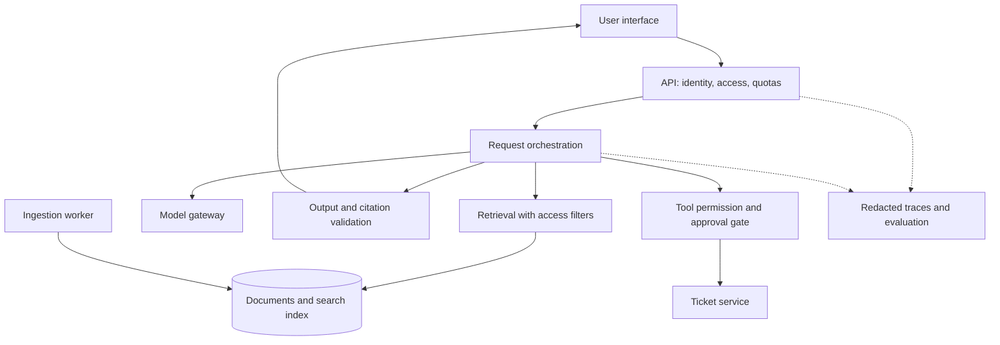

# AI Full Stack Engineering: From Model Calls to Reliable Products

**A practical guide to the role, essential skills, production architecture, and a 24-week learning roadmap**

[فارسی](ai-full-stack.fa.md) · [Home](../README.md) · [Sources and evidence notes](../resources/sources.md) · [Practical worksheets](../resources/worksheets.md)

**Research reviewed:** November 21, 2026. **Audience:** developers, career changers, technical founders, and engineering leads. The main track assumes basic programming; beginners get a separate foundation track.

> An AI Full Stack engineer connects a user problem to a working AI product—and can show, with evidence, how well it works, what it costs, where it fails, and how to operate it.

## Contents

1. [What the role actually means](#1-what-the-role-actually-means)
2. [Responsibilities and neighboring roles](#2-responsibilities-and-neighboring-roles)
3. [The skill map](#3-the-skill-map)
4. [Choosing an architecture](#4-choosing-an-architecture)
5. [A production reference architecture](#5-a-production-reference-architecture)
6. [Building retrieval that deserves trust](#6-building-retrieval-that-deserves-trust)
7. [Tool use, agents, and MCP](#7-tool-use-agents-and-mcp)
8. [Evaluation as an engineering discipline](#8-evaluation-as-an-engineering-discipline)
9. [Security, privacy, and governance](#9-security-privacy-and-governance)
10. [Operating quality, latency, and cost](#10-operating-quality-latency-and-cost)
11. [A 24-week roadmap](#11-a-24-week-roadmap)
12. [Three portfolio projects](#12-three-portfolio-projects)
13. [Demonstrating professional readiness](#13-demonstrating-professional-readiness)
14. [Common mistakes and practical answers](#14-common-mistakes-and-practical-answers)
15. [Your first seven days](#15-your-first-seven-days)

## 1. What the role actually means

“AI Full Stack,” “Full Stack AI Engineer,” and “AI Product Engineer” are useful working labels, but this guide does not treat them as an internationally standardized occupation. Read the responsibilities in a job description before relying on its title. Some companies emphasize product delivery; others expect model training or infrastructure expertise.

Here, **AI Full Stack engineering means building and operating the application around AI across the product lifecycle**: interface, backend, data, model integration, evaluation, deployment, and improvement. Its scope is deliberately broader than writing prompts, and usually narrower than researching or pretraining foundation models.

There are three different ideas people can confuse:

| Idea | Central activity | Evidence of competence |
|---|---|---|
| AI-assisted full-stack development | Using coding assistants to develop ordinary software | Correct, tested, maintainable software |
| Full-stack AI application engineering | Delivering software whose behavior depends on AI | A useful application with measured AI quality and reliable operation |
| Full-stack model development | Owning data, training, inference, and deployment of models | Reproducible training and serving systems |

This article focuses on the second. A developer can use an AI assistant without building an AI product; an AI product engineer may also use coding assistants.

The underlying work is not entirely new. Full Stack Deep Learning's 2023 LLM Bootcamp already covered foundations, augmented models, language interfaces, and LLMOps. Contemporary OpenAI and Anthropic career pages also show full-stack roles alongside applied AI and AI product work. These observations illustrate overlapping responsibilities; they do **not** establish when a title was invented or prove a particular hiring growth rate. [FSDL curriculum](https://fullstackdeeplearning.com/llm-bootcamp/), [OpenAI careers](https://openai.com/careers/search/), [Anthropic careers](https://www.anthropic.com/careers/jobs).

Why does the role matter? A model can generate a convincing response while the product retrieves the wrong document, leaks another customer's data, charges for repeated retries, or leaves a user unable to correct an error. Owning the connections between layers is a substantial engineering responsibility.

## 2. Responsibilities and neighboring roles

A typical delivery loop is: define the task → establish a baseline → build the smallest useful system → evaluate → release carefully → inspect failures → improve.

| Role | Typical center of gravity | Overlap with AI Full Stack |
|---|---|---|
| Full-stack engineer | Web interface, services, database | Application foundation |
| AI engineer | Model integration and AI behavior | Prompts, retrieval, tools, evaluations |
| ML engineer | Training/adaptation, inference, ML pipelines | Model deployment and data workflows |
| Data scientist | Analysis, experiments, statistical modeling | Measurement and experimental design |
| MLOps/platform engineer | Shared infrastructure and operational tooling | Releases, observability, reliability |
| Research scientist | New methods and scientific experiments | Deeper model work where required |

These are practical distinctions, not exclusive boundaries. In a small team, one person may cover several areas. In a large organization, specialists share them. “Full stack” describes breadth of understanding and ownership, not an expectation that one person replaces an entire department.

Useful deliverables include a task specification, a working interface and API, an evaluation dataset, a measured comparison of alternatives, a threat model, deployment instructions, and a record of known limitations. A chat screenshot alone demonstrates very little about these capabilities.

## 3. The skill map

### 3.1 Software and web foundations

Learn one backend language well. **Python plus TypeScript** is a practical example combination, not a requirement. An all-TypeScript application can be sensible; Python becomes especially useful when working with ML tooling.

You should be comfortable with:

- Functions, types, collections, exceptions, async execution, dependency management, and debugging.
- Git, code review, readable modules, tests, and command-line tools.
- HTML, CSS, JavaScript/TypeScript, HTTP, browser/server boundaries, and accessible forms.
- API contracts, input validation, authentication, authorization, SQL, transactions, indexes, and database migrations.
- Timeouts, bounded retries with backoff, queues, idempotency, concurrency limits, and configuration management.

**Practice:** build a small document application with login, uploads, search, and access restrictions before adding a model. MDN and the official FastAPI tutorial provide useful foundation material. [MDN](https://developer.mozilla.org/en-US/docs/Learn_web_development), [FastAPI](https://fastapi.tiangolo.com/tutorial/).

### 3.2 AI and mathematical literacy

Understand tokens, embeddings, similarity, context windows, inference, sampling, training versus inference, and why fluent text is not proof of correctness. Learn enough linear algebra to reason about vectors and dot products, and enough probability and statistics to interpret variation, precision/recall, sampling bias, and uncertainty.

Also learn train/validation/test separation, data leakage, overfitting, and the difference between a benchmark and your users' tasks. You do not need to implement a transformer from scratch before shipping an API-based application. You need deeper optimization, GPU, and distributed training knowledge if your chosen role includes model development. [Google ML Crash Course](https://developers.google.com/machine-learning/crash-course), [Hugging Face LLM Course](https://huggingface.co/learn/llm-course/chapter1/1).

### 3.3 Model integration and context design

Treat each model interaction as a versioned component:

- Specify task, evidence, constraints, examples, and failure behavior.
- Distinguish trusted instructions from user input, retrieved documents, and tool results.
- Budget context deliberately: select relevant material, manage conversation state, and exclude unauthorized data.
- Use structured output when downstream software needs a schema; handle refusal, truncation, and validation failures explicitly.
- Compare models on your own examples, including the actual languages and document types you support.

Schema adherence and factual accuracy are different properties. Structured output can still contain incorrect values. Validate business rules in application code. [OpenAI structured outputs](https://developers.openai.com/api/docs/guides/structured-outputs).

### 3.4 Data and retrieval engineering

Learn ingestion, document parsing, OCR quality checks, chunking, metadata, lexical and vector search, reranking, deduplication, provenance, updates, and deletion. Understand why an approximate nearest-neighbor index trades retrieval behavior for speed and why filters affect results. PostgreSQL with pgvector is one possible starting point; a separate vector service is a decision to justify, not an entry requirement. [pgvector documentation](https://github.com/pgvector/pgvector).

### 3.5 Evaluation, product judgment, and communication

Define a useful outcome before choosing a model. Interview potential users, observe their existing workflow, estimate the cost of errors, and design a correction path. Explain tradeoffs in plain language. Know when a deterministic rule, search interface, or human review is sufficient.

Evaluation includes software tests, task-specific quality measurements, adversarial cases, and product outcomes. These responsibilities should begin with the first prototype, rather than wait until deployment.

### 3.6 Deployment and operations

Know containers, CI/CD, secrets management, logs, metrics, traces, backups, restore procedures, and staged rollout. Learn the basics of cloud networking and service permissions. Kubernetes and complex infrastructure become useful when operational requirements justify them; they are not mandatory first steps.

### 3.7. How much depth do you need?

Use this capability ladder to prioritize study. The levels are this guide's recommendations for an application-focused role.

| Capability | Build independently | Extend as the project requires |
|---|---|---|
| Application engineering | UI, API, SQL, identity, tests, deployment | Distributed systems at larger scale |
| Model integration | Prompts, schemas, state, errors, usage accounting | Provider routing and model adaptation |
| Data/retrieval | Parsing, metadata, access filtering, retrieval measurement | Specialized indexes and advanced ranking |
| Evaluation | Curated cases, rubrics, regression reports, human review | Larger experiments and statistical study design |
| Security/operations | Permission checks, safe output, monitoring, rollback | Specialized security or platform engineering |
| Model internals | Explain training/inference, tokens, embeddings, context | Implement/train models if the role needs it |

Choose a deeper specialty after the shared foundation: AI product/UX, retrieval and data, agent/tool workflows, model adaptation, inference infrastructure, or AI evaluation/security. Breadth becomes more useful when paired with depth in at least one area.

## 4. Choosing an architecture

The following decision table is an editorial engineering heuristic. Validate it against the problem and evaluation results.

| Situation | First approach to test | Reason to add complexity |
|---|---|---|
| Stable, explicit business rules | Ordinary code | Rules cannot adequately describe the task |
| Bounded extraction or classification | Model call with schema and validation | Error analysis shows a specific limitation |
| Answers depend on private/changing documents | Retrieval plus generation | Retrieval quality or context coverage is inadequate |
| Live inventory, account state, or calculations | Permissioned API/tool calls | Several dependent steps are necessary |
| A repeatable multi-step process | Explicit workflow | Next steps cannot reasonably be predefined |
| Open-ended task with observable feedback | A bounded agent | Agent improves outcomes enough to justify cost/risk |
| Repeated behavior/style errors with good training data | Evaluate fine-tuning | Prompt/context improvements have reached limits |

RAG supplies retrieved information at inference time. Fine-tuning changes model parameters through training. They solve different problems and can be combined; neither automatically produces factual correctness. The original RAG paper is useful background, while model optimization documentation describes an evaluation-led path through prompting and fine-tuning. [Lewis et al., RAG](https://arxiv.org/abs/2005.11401), [OpenAI model optimization](https://developers.openai.com/api/docs/guides/model-optimization).

Before self-hosting, compare data requirements, provider availability, measured quality, expected traffic, hardware utilization, and operating effort. A model with downloadable weights does not automatically grant every commercial use: inspect its license. Do not assume self-hosting is cheaper without a utilization and staffing model.

## 5. A production reference architecture

Consider a bilingual internal knowledge assistant. Employees ask questions about approved policies and receive answers with source excerpts. The first release can draft a support ticket, but a user must confirm submission.



An example learning stack is a TypeScript/React interface, a Python/FastAPI backend, PostgreSQL, pgvector if needed, object storage, a background worker, a model-provider adapter, containers, and CI. These are examples, not a ranked product recommendation or a requirement to use two backend stacks.

Keep business rules and permission checks in your application. The model provider adapter should expose consistent internal request/result types while acknowledging that providers differ in tool behavior, context limits, output formats, and refusal handling.

Keep ingestion separate from serving: parsing and indexing large files should not hold a user request open. Store document ID, version, source location, access metadata, ingestion status, and deletion state. If a document is removed or permissions change, update all derived copies that your system controls.

A reasonable portfolio repository might contain:

```text
apps/web/          # interface and user flows
services/api/      # identity, orchestration, authorization
workers/           # parsing and indexing
schemas/           # request, output, and tool contracts
prompts/           # versioned templates
evals/            # datasets, rubrics, runners, reports
infra/             # deployment configuration
docs/             # architecture, threat model, runbook
```

Directory names are illustrative; avoid architectural ceremony that does not help the project.

## 6. Building retrieval that deserves trust

A dependable retrieval pipeline is more than “put files in a vector database.”

1. **Establish provenance and rights.** Use data you are allowed to process and store. Record source, owner, version, and permitted audience.
2. **Parse and inspect.** Check headings, tables, page references, scanned text, and repeated headers. A faulty extraction can make every later stage look like a model failure.
3. **Chunk around meaning.** Preserve enough context for an answer. Treat chunk size and overlap as experiment variables rather than universal constants.
4. **Attach access metadata.** Derive user and tenant identity from the authenticated server context. Constrain retrieval before any text reaches the model; verify candidate documents again if needed.
5. **Establish a search baseline.** Compare lexical retrieval with vector or hybrid retrieval on representative questions. Add reranking only when it improves the measured task enough to justify the overhead.
6. **Assemble context.** Remove duplicate passages, preserve document identity, and fit useful evidence into the context budget.
7. **Generate and verify.** Require references to retrieved identifiers, check identifiers and access rights in code, and assess whether cited passages support the answer. A valid URL alone does not establish support.
8. **Maintain the system.** Reindex changed content and propagate deletion to chunks, vectors, caches, and stored context according to your retention design.

For Persian, test Arabic/Persian character variants, half-spaces, mixed Latin terms, dates, tables, and Persian/English questions about the same content. Normalize search representations carefully while preserving the original display text. Measure cross-language retrieval rather than assuming a multilingual embedding model handles it well.

If no adequate evidence is found, return a useful abstention: explain what is missing, offer a more specific query, or route to a human. A confident invented policy is a failed product outcome.

## 7. Tool use, agents, and MCP

A tool call is a model-generated request for your application to perform an operation. Your application executes it; the model's request is not authorization. Validate arguments, the authenticated actor, resource access, and allowed actions. [OpenAI function calling](https://developers.openai.com/api/docs/guides/function-calling).

A **workflow** follows paths specified in code. An **agent** lets the model choose its next action within a controlled environment. Anthropic's foundational guide recommends starting with a simple solution and adding agentic complexity when it earns its latency and cost. Its 2024 examples are architectural background, not a promise that every mentioned tool remains current. [Building effective agents](https://www.anthropic.com/research/building-effective-agents).

A practical tool contract specifies input/output schema, permissions, side effects, timeout, rate limits, error behavior, and retry semantics. For consequential writes, make confirmation concrete: show the exact ticket or change, bind approval to that version, and prevent a later model step from silently modifying it. Use idempotency keys where the downstream system supports them, and reconcile uncertain outcomes before retrying a write.

Restrict tool authority to what the workflow requires. [OWASP excessive agency](https://genai.owasp.org/llmrisk/llm062025-excessive-agency/).

Set maximum steps, elapsed time, token/spend budgets, and allowed tools. Give the agent a stop condition and an escalation path. Read-only tools are a useful starting point. Multi-agent designs add coordination, duplicated context, and more failure paths; require comparative evidence before adopting them.

**MCP** standardizes integration between AI applications and external context/tools. Learn its host/client/server model, lifecycle, schemas, and authorization requirements when your integrations need it. It does not remove your responsibility for business authorization or trustworthy tool execution. The reviewed specification is dated 2026-07-28; pin compatible versions in an implementation. [Official MCP specification](https://modelcontextprotocol.io/specification/2026-07-28).

## 8. Evaluation as an engineering discipline

An evaluation asks whether a particular system succeeds on a defined task under stated conditions. Start with a small, manually inspected dataset and a simple baseline. Keep a development set for iteration and a held-out test set for less biased comparisons. Production examples need appropriate permission and redaction. [OpenAI evaluation best practices](https://developers.openai.com/api/docs/guides/evaluation-best-practices).

For the knowledge assistant, consider these separate measurements:

| Layer | Example question | Measurement |
|---|---|---|
| Retrieval | Did we retrieve the needed document? | Recall@k over labeled relevant documents |
| Answer | Are material statements correct and supported? | Human rubric and claim-level support checks |
| Citation | Does the cited passage support this statement? | Supported citations / checked citations |
| Abstention | Does the system decline unanswerable questions? | Separate correct-abstention and false-abstention rates |
| Tool execution | Was the correct permitted action completed? | Verified task success and duplicate-write rate |
| Security | Can one tenant access another's information? | Cross-tenant test failures; release blocker if any |
| Operations | Does the user receive a timely useful result? | p50/p95 latency, time to first token, error rate |
| Product | Does this improve the actual workflow? | Completion, correction rate, measured time saved |

When a question has several relevant documents, document Recall@k is the fraction of those documents appearing in the top k results; report how you average across questions. If you label only one required document, hit rate may be a clearer metric name. Likewise, “groundedness” must come with an explicit rubric, not an unexplained percentage.

Include ordinary cases, missing evidence, conflicting/obsolete documents, malicious content, provider errors, long inputs, denied access, and Persian/English mixed inputs. Evaluate the whole workflow as well as individual components.

LLM judges can help scale review, but may share model biases or prefer superficial style. Calibrate them against human labels, record the judge model and rubric, and inspect disagreements. Repeat important nondeterministic comparisons and report sample sizes and uncertainty. A score on 50 questions is not proof of universal reliability. [Anthropic agent evaluations](https://www.anthropic.com/research/demystifying-evals-for-ai-agents).

A model or prompt change should produce a comparison report containing dataset version, prompt/model/settings, code revision, quality breakdown, latency, cost, failures, and release decision. Never invent benchmark results for a portfolio. The worksheets include an explicitly hypothetical release gate you can adapt.

## 9. Security, privacy, and governance

Treat external text as untrusted. Instructions can arrive through a retrieved document or tool output, not just the chat input. A system prompt is not a reliable access-control boundary. [OWASP prompt injection](https://genai.owasp.org/llmrisk/llm01-prompt-injection/).

OWASP's reviewed **2025** list covers prompt injection, sensitive information disclosure, supply chain, poisoning, improper output handling, excessive agency, system prompt leakage, vector/embedding weaknesses, misinformation, and unbounded consumption. We name the reviewed edition explicitly instead of assuming it is the newest release everywhere. [OWASP LLM Top 10](https://genai.owasp.org/llm-top-10/).

Apply the risks to your design:

- Enforce authorization outside the model; test cross-tenant retrieval, caches, conversation histories, and exported artifacts.
- Render model output safely. Use parameterized database queries and explicit tool allowlists; never directly execute generated SQL, shell commands, or HTML. [OWASP output handling](https://genai.owasp.org/llmrisk/llm052025-improper-output-handling/).
- Isolate parsers and code execution where applicable; restrict network egress and file access.
- Keep secrets server-side. Scan dependencies, pin versions, and inspect model/data licenses and provenance.
- Bound input size, uploads, tool steps, output length, concurrency, and spend. Add abuse controls and a kill switch.
- Minimize data sent to providers. Review applicable provider retention and processing terms for the actual service and configuration you use; do not assume one vendor-wide promise.
- Define log access, retention, deletion, and incident handling. Traces can themselves contain sensitive information.

PostgreSQL row-level security can support database isolation, but table owners and privileged roles can bypass policies in relevant circumstances; test using the actual runtime role. RLS is one layer, not an assurance that every vector query or cache is isolated. [PostgreSQL row security](https://www.postgresql.org/docs/current/ddl-rowsecurity.html).

For governance, record intended use, affected users, foreseeable failures, responsible owners, monitoring, and escalation. NIST AI 600-1 is a voluntary generative-AI risk-management resource, not a certification obtained by adding a checklist. [NIST publication](https://www.nist.gov/publications/artificial-intelligence-risk-management-framework-generative-artificial-intelligence).

## 10. Operating quality, latency, and cost

Trace the path from request through retrieval, generation, validation, and tools. A trace contains spans describing component work, allowing you to investigate where time or failures accumulated. Redact content and control access before collecting it. [OpenTelemetry traces](https://opentelemetry.io/docs/concepts/signals/traces/).

Record model and prompt versions, retrieval configuration, input/output usage, retries, stage timings, tool outcomes, error class, and a request correlation ID. Prefer metadata over raw sensitive content.

Use both **cost per request** and **cost per successful task**. A useful planning model is:

```text
request cost = sum over model calls [(input tokens × input rate
                                    + output tokens × output rate) / rate unit]
             + retrieval + reranking + tool charges
             + allocated infrastructure

cost per successful task = all measured workload costs / verified successful tasks
```

Apply the provider's actual accounting for cached input, reasoning usage, media, minimum charges, and other billed categories. Do not assume the simplified token expression captures every API.

**Hypothetical calculation, not vendor pricing:** if a call uses 3,000 input tokens at $1 per million and 500 output tokens at $4 per million, its model cost is $0.005. One thousand such calls cost $5 before other charges. If only 800 of those 1,000 tasks succeed and no other costs exist, cost per success is $0.00625. Repeated agent calls and retries must be counted too.

Set latency and availability objectives from the workflow. Streaming can reduce perceived waiting but does not necessarily shorten total completion time. Optimize with measured context reduction, appropriate models, safe caching, or parallel independent work. Cache keys must account for tenant, authorization, data version, and configuration; stale or cross-user answers are not a worthwhile saving.

Release behind a feature flag to a small audience, compare results, then expand. Keep a known-good configuration, rollback procedure, provider-outage behavior, restore exercise, and incident owner. Re-run evaluations after relevant model, prompt, retrieval, or data changes.

## 11. A 24-week roadmap

**Planning assumption:** 10–12 focused hours per week for someone who already knows basic programming. This is an editorial study plan, not a research-backed time-to-employment prediction. Each stage ends with evidence; extend it if you cannot meet the gate.

If you are starting from zero, first allow roughly **8–12 additional weeks**, adjusting to your pace, for programming, Git, HTTP, SQL, and a deployed CRUD application. If you are an experienced full-stack developer, test out of the early stages with the same deliverables. If you come from ML, spend extra effort on identity, UI behavior, databases, and operations.

| Weeks | Focus | Work to deliver | Exit gate |
|---|---|---|---|
| 1–2 | Product and baseline | One-page problem statement, user workflow, 20 representative examples, non-AI baseline | Explain value, error costs, and why AI may help |
| 3–4 | Backend and data | Validated API, SQL schema/migrations, login and permissions | Tests deny access to another user's records |
| 5–6 | Interface and deployment | Accessible upload/question flow, loading/error/cancel states, deployed app | Another person completes the flow without your help |
| 7–8 | Model integration | Provider adapter, versioned prompt, schema validation, failure handling | Compare two prompt/model configurations on the same examples |
| 9–10 | Retrieval | Licensed corpus, ingestion worker, metadata and lexical/vector baseline | Labeled retrieval report and working update/delete flow |
| 11–12 | Answer quality | Evidence-based answers, citation checks, abstention and bilingual cases | Diagnose retrieval errors separately from generation errors |
| 13–14 | Tools and workflow | One read tool and one write tool with confirmation and idempotency design | Denied access, timeout, uncertain outcome, and duplicate retry are handled |
| 15–16 | Evaluation system | At least 100 curated cases, held-out split, rubric, regression report | Repeatable comparison with disclosed sample sizes and failures |
| 17–18 | Threat model | Data-flow review, injection and cross-tenant tests, output sanitization | No failures in defined access-control tests; remaining risks documented |
| 19–20 | Operations | Traces, budget/quota controls, load test, staged release and rollback | Demonstrate an outage and rollback without losing required state |
| 21–22 | Optimization | One controlled improvement to quality, cost, or latency | Before/after report shows benefit without violating other gates |
| 23–24 | Portfolio and review | Demo, architecture, eval report, runbook, limitations, user feedback | A peer can run the project and explain its tradeoffs |

Suggested weekly rhythm: two hours of reading, six to eight hours of building, and two hours of measurement/documentation. Prefer one coherent project over a new framework every week. The 100-case target is a learning milestone, not a statistically sufficient certification for a production system.

### Resource sequence

Use MDN and the FastAPI tutorial for application foundations; Google's ML Crash Course for ML literacy; Hugging Face for deeper language-model concepts; FSDL for AI product lifecycle material; the selected provider's current documentation for implementation; OWASP and NIST for security/risk reviews; and OpenTelemetry for observability. The [source index](../resources/sources.md) explains the purpose and limits of each reference.

## 12. Three portfolio projects

### Project A: Structured document extraction

Extract specified fields from a small corpus of permitted invoices or forms, then let a user review corrections. Include malformed files, missing fields, conflicting totals, and irrelevant documents.

**Evidence:** field-level correctness, document-level success, abstention behavior, correction UI, and cost per accepted document. Validate arithmetic with code. Use synthetic or genuinely shareable samples, not exposed customer records.

### Project B: Persian–English knowledge assistant

Use a versioned set of public or authorized policies. Add citations, access restrictions, bilingual questions, document updates, and deletion.

**Evidence:** retrieval baseline, answer-support rubric, cross-language cases, permission tests, and a trace showing why a failed answer failed. Show an unanswerable question in the demo as well as successful ones.

### Project C: Support workflow with controlled actions

Search knowledge, fetch an authorized ticket, propose a response or update, show a preview, and write only after confirmation. Start with an explicit workflow; add a bounded agent only if evaluation shows benefit.

**Evidence:** tool contract, approval binding, idempotency or reconciliation design, attack cases, outage handling, and comparison against the simpler workflow. A simulated integration is acceptable if clearly labeled.

For every project, publish setup instructions, architecture, test data provenance, evaluation method, actual measured results, costs with measurement conditions, limitations, and a brief failure analysis. A short video can explain the flow, but reproducible evidence should remain in the repository.

## 13. Demonstrating professional readiness

You are becoming ready for applied work when you can do these things without hiding behind a framework:

- Turn an ambiguous request into an observable task and an evaluation rubric.
- Build, deploy, and debug the interface, API, and data path.
- Explain the choice between code, model calls, retrieval, tools, fine-tuning, and agents.
- Diagnose whether a bad answer came from data, retrieval, context, generation, validation, or UI.
- Demonstrate tenant isolation, safe tool execution, budget controls, and a working rollback.
- Discuss real failures and measured tradeoffs with someone outside the project.

In interviews, prepare to answer: Why this architecture? What is the simplest baseline? How do you know it improved? What happens when the provider fails? What would prevent an unauthorized write? Which part of your evaluation might be biased?

Describe outcomes truthfully on a résumé. For example, “Compared two retrieval configurations on 120 labeled questions and documented their quality/latency tradeoff” is useful if actually done. Do not copy hypothetical numbers from this guide into professional claims.

## 14. Common mistakes and practical answers

**Do I need a PhD or advanced mathematics?** Not as a universal prerequisite for the application-focused scope described here. Actual requirements depend on the employer and specialization. Deeper model research has different demands.

**Must I learn every framework?** No. First understand the provider call, context assembly, tool execution, and evaluation loop. Introduce a framework when it removes concrete maintenance work without obscuring behavior you need to debug.

**Should I start by fine-tuning?** First inspect the errors. Missing fresh knowledge may call for retrieval; a calculation may call for code; repeated behavior errors with suitable examples may justify fine-tuning experiments.

**Is RAG a hallucination cure?** No. Wrong retrieval, stale evidence, contradictory passages, or unsupported synthesis can still produce incorrect answers.

**Does a passing evaluation mean it is safe?** It establishes evidence only for the tested conditions. Monitor deployed behavior and expand coverage as new failures appear.

**Can coding assistants do the job for me?** They can accelerate implementation. You still need to inspect changes, protect secrets, test permissions, verify dependencies, and understand what you ship.

**What about voice, images, or video?** Treat them as specializations after the core loop. Add modality-specific data handling, quality metrics, consent/rights where relevant, latency constraints, and evaluation cases. A text-only evaluation does not validate a voice assistant.

## 15. Your first seven days

1. Choose one narrow workflow and interview a potential user.
2. Write down success, unacceptable failures, and a non-AI baseline.
3. Collect 20 permitted examples, including several that should fail or abstain.
4. Build the smallest API and interface for one model interaction.
5. Add validation, bounded timeouts, and explicit error behavior.
6. Evaluate every example; classify failures and measure usage and latency.
7. Publish a clear README with what worked, what failed, and the next experiment.

The professional habit to develop is straightforward: make a useful claim about a product, gather evidence for it, and keep responsibility for the system after the demo ends.

---

**Editorial note:** the role definition, architecture, study schedule, portfolio briefs, and example thresholds are the guide's synthesis. Linked research and official documentation support specific technical concepts; they do not endorse this article or guarantee career outcomes. Both language editions follow the same scope. See [sources and evidence notes](../resources/sources.md).
