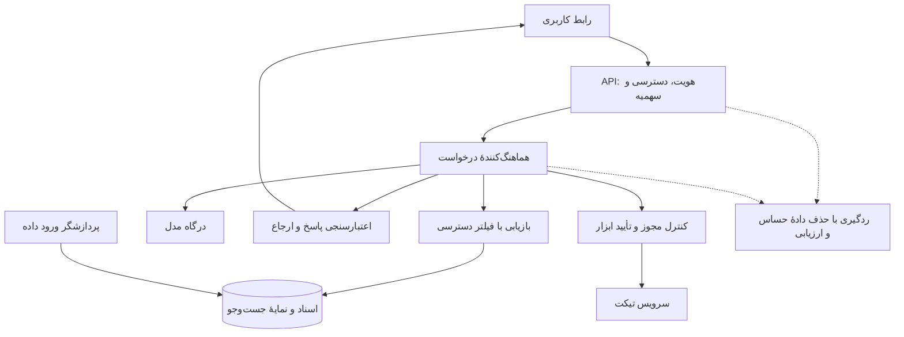

# مهندسی AI Full Stack؛ از فراخوانی مدل تا ساخت محصول قابل‌اعتماد

**راهنمای کاربردی شناخت نقش، مهارت‌های ضروری، معماری محصول و نقشهٔ راه ۲۴هفته‌ای**

[English](ai-full-stack.en.md) · [صفحهٔ اصلی](../README.md) · [منابع و یادداشت‌های پژوهش](../resources/sources.md) · [کاربرگ‌های عملی](../resources/worksheets.md)

**تاریخ بازبینی منابع:** ۲۱ نوامبر ۲۰۲۶. **مخاطب:** برنامه‌نویس‌ها، افرادی که می‌خواهند مسیر شغلی‌شان را تغییر دهند، بنیان‌گذاران فنی و مدیران مهندسی. مسیر اصلی برای کسی طراحی شده که مقدمات برنامه‌نویسی را می‌داند؛ برای شروع از صفر نیز مسیر جداگانه داریم.

> مهندس AI Full Stack مسئلهٔ کاربر را به یک محصول هوش مصنوعی عملیاتی تبدیل می‌کند و می‌تواند با شواهد نشان دهد که محصول چقدر خوب کار می‌کند، چه هزینه‌ای دارد، کجا شکست می‌خورد و چگونه باید نگهداری شود.

## فهرست مطالب

- [۱. این نقش دقیقاً چیست؟](#role)
- [۲. مسئولیت‌ها و تفاوت با نقش‌های نزدیک](#responsibilities)
- [۳. نقشهٔ مهارت‌ها](#skills)
- [۴. انتخاب معماری مناسب](#decisions)
- [۵. معماری مرجع یک محصول واقعی](#architecture)
- [۶. ساخت بازیابی قابل‌اعتماد](#retrieval)
- [۷. ابزارها، ایجنت‌ها و MCP](#agents)
- [۸. ارزیابی به‌عنوان یک فعالیت مهندسی](#evaluation)
- [۹. امنیت، حریم خصوصی و مدیریت ریسک](#security)
- [۱۰. مدیریت کیفیت، تأخیر و هزینه](#operations)
- [۱۱. نقشهٔ راه ۲۴هفته‌ای](#roadmap)
- [۱۲. سه پروژه برای نمونه‌کار](#portfolio)
- [۱۳. آمادگی حرفه‌ای و استخدام](#readiness)
- [۱۴. خطاهای رایج و پرسش‌های مهم](#faq)
- [۱۵. برنامهٔ هفت روز اول](#first-week)

<a id="role"></a>
## ۱. این نقش دقیقاً چیست؟

عنوان‌هایی مثل «AI Full Stack»، «Full Stack AI Engineer» و «AI Product Engineer» برای توصیف یک محدودهٔ کاری مفیدند؛ اما در این راهنما آن‌ها را یک شغل با تعریف استاندارد و یکسان در سراسر جهان فرض نمی‌کنیم. پیش از تکیه بر عنوان، شرح مسئولیت‌های آگهی را بخوانید. بعضی شرکت‌ها بر ساخت محصول تمرکز دارند و بعضی انتظار تخصص در آموزش مدل یا زیرساخت را هم مطرح می‌کنند.

تعریف عملیاتی ما چنین است: **مهندسی AI Full Stack یعنی ساخت و نگهداری اپلیکیشنی که از هوش مصنوعی استفاده می‌کند، در سراسر چرخهٔ محصول**؛ از رابط کاربری و بک‌اند تا داده، اتصال مدل، ارزیابی، استقرار و بهبود. این کار از نوشتن پرامپت گسترده‌تر است و معمولاً به معنای پژوهش یا پیش‌آموزش مدل‌های بنیادین نیست.

سه مفهوم متفاوت را باید از هم تشخیص داد:

| مفهوم | فعالیت اصلی | نشانهٔ توانمندی |
|---|---|---|
| توسعهٔ فول‌استک با کمک AI | استفاده از دستیار کدنویسی برای ساخت نرم‌افزار | کد درست، آزموده و قابل‌نگهداری |
| مهندسی اپلیکیشن AI در کل پشته | ساخت محصولی که رفتار آن به هوش مصنوعی وابسته است | محصول مفید همراه با سنجش کیفیت و عملیات قابل‌اعتماد |
| توسعهٔ مدل در کل پشته | مالکیت مسیر داده، آموزش، سروینگ و استقرار مدل | فرایند بازتولیدپذیر آموزش و اجرای مدل |

موضوع این مقاله، مفهوم دوم است. کسی می‌تواند با دستیار کدنویسی کار کند، اما محصول هوش مصنوعی نسازد؛ یک مهندس محصول AI نیز می‌تواند از دستیار کدنویسی استفاده کند.

آیا این نقش کاملاً تازه است؟ بهتر است دقیق حرف بزنیم. بوت‌کمپ LLM مجموعهٔ Full Stack Deep Learning در سال ۲۰۲۳، مبانی مدل، مدل‌های تقویت‌شده، رابط‌های زبانی و LLMOps را پوشش می‌داد. صفحه‌های شغلی فعلی OpenAI و Anthropic نیز نقش‌های فول‌استک را در کنار فعالیت‌های هوش مصنوعی کاربردی و محصول نشان می‌دهند. این شواهد، هم‌پوشانی مسئولیت‌ها را نشان می‌دهند؛ از آن‌ها نمی‌توان تاریخ تولد این عنوان یا نرخ رشد استخدام آن را نتیجه گرفت. [برنامهٔ FSDL](https://fullstackdeeplearning.com/llm-bootcamp/)، [فرصت‌های شغلی OpenAI](https://openai.com/careers/search/)، [فرصت‌های شغلی Anthropic](https://www.anthropic.com/careers/jobs).

اهمیت این نقش در اتصال لایه‌هاست. مدل ممکن است پاسخی قانع‌کننده تولید کند، اما محصول سند اشتباه را بازیابی کرده باشد، اطلاعات مشتری دیگری را نشان دهد، برای تلاش‌های تکراری هزینه بسازد یا راه اصلاح خطا را از کاربر بگیرد. مسئولیت این اتصال‌ها، یک مسئلهٔ جدی مهندسی است.

<a id="responsibilities"></a>
## ۲. مسئولیت‌ها و تفاوت با نقش‌های نزدیک

چرخهٔ کاری پیشنهادی چنین است: تعریف مسئله ← ساخت خط مبنا ← ساخت کوچک‌ترین سیستم مفید ← ارزیابی ← انتشار تدریجی ← تحلیل شکست‌ها ← بهبود.

| نقش | کانون معمول فعالیت | بخش مشترک با AI Full Stack |
|---|---|---|
| مهندس فول‌استک | رابط، سرویس‌ها و پایگاه داده | پایهٔ اپلیکیشن |
| مهندس AI | اتصال مدل و مهندسی رفتار سیستم | پرامپت، بازیابی، ابزار و ارزیابی |
| مهندس ML | آموزش یا تطبیق مدل، اجرای مدل و پایپ‌لاین‌های ML | استقرار مدل و گردش داده |
| دانشمند داده | تحلیل، آزمایش و مدل‌سازی آماری | سنجش و طراحی آزمایش |
| مهندس MLOps یا پلتفرم | زیرساخت مشترک و ابزارهای عملیاتی | انتشار، مشاهده‌پذیری و پایداری |
| پژوهشگر | روش‌های تازه و آزمایش علمی | کار عمیق‌تر روی مدل، در صورت نیاز |

این مرزها عملی‌اند و انحصاری نیستند. در تیم کوچک ممکن است یک نفر چند مسئولیت داشته باشد؛ در سازمان بزرگ، متخصصان آن‌ها را تقسیم می‌کنند. فول‌استک بودن به معنای فهم و مالکیت مسیر کلی است؛ به معنای جایگزین کردن یک دپارتمان با یک نفر نیست.

خروجی حرفه‌ای این نقش می‌تواند شامل تعریف وظیفه، رابط و API فعال، مجموعه‌دادهٔ ارزیابی، مقایسهٔ اندازه‌گیری‌شدهٔ گزینه‌ها، مدل تهدید، راهنمای استقرار و فهرست محدودیت‌ها باشد. اسکرین‌شات یک چت، به‌تنهایی شواهد چندانی دربارهٔ این توانایی‌ها ارائه نمی‌کند.

<a id="skills"></a>
## ۳. نقشهٔ مهارت‌ها

### ۳.۱. پایه‌های مهندسی نرم‌افزار و وب

یک زبان بک‌اند را خوب یاد بگیرید. ترکیب **Python و TypeScript** یک انتخاب عملی نمونه است، نه شرط ورود. اپلیکیشن کاملاً مبتنی بر TypeScript نیز می‌تواند منطقی باشد؛ پایتون به‌ویژه هنگام کار با ابزارهای یادگیری ماشین مفید می‌شود.

باید بر این موضوعات مسلط شوید:

- تابع، نوع داده، ساختارهای داده، مدیریت خطا، اجرای ناهمگام، وابستگی‌ها و اشکال‌زدایی؛
- Git، بازبینی کد، ماژول‌های خوانا، آزمون و خط فرمان؛
- HTML، CSS، JavaScript یا TypeScript، پروتکل HTTP، مرز مرورگر و سرور و فرم‌های دسترس‌پذیر؛
- قرارداد API، اعتبارسنجی ورودی، احراز هویت، کنترل دسترسی، SQL، تراکنش، ایندکس و مهاجرت پایگاه داده؛
- مهلت زمانی، تلاش مجدد محدود با فاصلهٔ افزایشی، صف، محدودیت هم‌زمانی و مدیریت تنظیمات؛
- خاصیت idempotency؛ یعنی طراحی عملیات به‌گونه‌ای که تکرار همان درخواست، اثر ناخواستهٔ تازه‌ای ایجاد نکند.

**تمرین:** پیش از افزودن مدل، یک اپلیکیشن کوچک اسناد بسازید که ورود کاربر، بارگذاری، جست‌وجو و محدودیت دسترسی داشته باشد. برای مبانی وب و API می‌توانید از MDN و آموزش رسمی FastAPI استفاده کنید. [MDN](https://developer.mozilla.org/en-US/docs/Learn_web_development)، [FastAPI](https://fastapi.tiangolo.com/tutorial/).

### ۳.۲. سواد هوش مصنوعی و ریاضیات

توکن، embedding، شباهت برداری، پنجرهٔ زمینه، استنتاج، نمونه‌گیری و تفاوت آموزش با اجرای مدل را بفهمید. بدانید متن روان، مدرک درستی پاسخ نیست. جبر خطی را در حد فهم بردار و ضرب داخلی، و احتمال و آمار را در حد تحلیل تغییرپذیری، precision و recall، سوگیری نمونه‌گیری و عدم قطعیت یاد بگیرید.

تفکیک دادهٔ آموزش، اعتبارسنجی و آزمون، نشت داده و بیش‌برازش نیز ضروری‌اند. نتیجهٔ یک بنچمارک عمومی با عملکرد روی وظایف کاربران شما یکسان نیست. برای ساخت اپلیکیشن مبتنی بر API لازم نیست ابتدا ترنسفورمر را از صفر پیاده‌سازی کنید؛ اگر نقش انتخابی شما شامل توسعهٔ مدل باشد، به دانش عمیق‌تر بهینه‌سازی، GPU و آموزش توزیع‌شده نیاز دارید. [دورهٔ فشردهٔ ML گوگل](https://developers.google.com/machine-learning/crash-course)، [دورهٔ LLM در Hugging Face](https://huggingface.co/learn/llm-course/chapter1/1).

### ۳.۳. اتصال مدل و طراحی زمینه

هر تعامل با مدل را یک مؤلفهٔ نسخه‌دار بدانید:

- وظیفه، شواهد، محدودیت‌ها، نمونه‌ها و رفتار هنگام شکست را مشخص کنید.
- دستورهای مورداعتماد را از ورودی کاربر، اسناد بازیابی‌شده و خروجی ابزار جدا کنید.
- زمینه را آگاهانه مدیریت کنید: اطلاعات مرتبط را انتخاب کنید، وضعیت مکالمه را نگه دارید و دادهٔ غیرمجاز را وارد نکنید.
- اگر نرم‌افزار پایین‌دستی به ساختار مشخص نیاز دارد، خروجی ساختاریافته بگیرید و رد درخواست، قطع خروجی و خطای اعتبارسنجی را مدیریت کنید.
- مدل‌ها را با نمونه‌های واقعی خودتان، در زبان‌ها و قالب‌های موردنیاز محصول، مقایسه کنید.

رعایت schema با صحت واقعیت‌ها فرق دارد. خروجی ساختاریافته همچنان ممکن است مقدار اشتباه داشته باشد. قواعد کسب‌وکار را در کد بررسی کنید. [مستندات خروجی ساختاریافتهٔ OpenAI](https://developers.openai.com/api/docs/guides/structured-outputs).

### ۳.۴. مهندسی داده و بازیابی

ورود داده، استخراج متن، بررسی کیفیت OCR، قطعه‌بندی، فراداده، جست‌وجوی واژگانی و برداری، بازرتبه‌بندی، حذف تکرار، منشأ داده، به‌روزرسانی و حذف را یاد بگیرید. بفهمید چرا جست‌وجوی تقریبی همسایه‌های نزدیک برای سرعت، بخشی از رفتار بازیابی را تغییر می‌دهد و فیلترها چگونه روی نتایج اثر می‌گذارند.

PostgreSQL همراه با pgvector یکی از نقطه‌های شروع ممکن است؛ استفاده از سرویس برداری جداگانه باید توجیه داشته باشد و پیش‌نیاز ورود به این حوزه نیست. [مستندات pgvector](https://github.com/pgvector/pgvector).

### ۳.۵. ارزیابی، قضاوت محصولی و ارتباط

پیش از انتخاب مدل، نتیجهٔ مفید را تعریف کنید. با کاربران احتمالی گفت‌وگو کنید، روش فعلی انجام کار را ببینید، هزینهٔ خطا را برآورد کنید و مسیر اصلاح بسازید. باید بتوانید بده‌بستان‌ها را با زبان ساده توضیح دهید و تشخیص دهید چه زمانی یک قانون قطعی، جست‌وجوی معمولی یا بازبینی انسانی کافی است.

ارزیابی شامل آزمون نرم‌افزار، سنجش کیفیت وظیفه، نمونه‌های خصمانه و نتیجهٔ واقعی برای کاربر است. این کار باید از نخستین نمونهٔ اولیه آغاز شود.

### ۳.۶. استقرار و عملیات

کانتینر، CI/CD، مدیریت رازها، لاگ، متریک، ردگیری، پشتیبان‌گیری، بازیابی و انتشار تدریجی را بشناسید. مبانی شبکهٔ ابری و مجوز سرویس‌ها را یاد بگیرید. Kubernetes و زیرساخت پیچیده زمانی ارزش دارند که نیاز عملیاتی آن‌ها را توجیه کند؛ اولین قدم اجباری نیستند.

### ۳.۷. عمق لازم در هر مهارت چقدر است؟

برای اولویت‌بندی مطالعه از جدول زیر استفاده کنید. سطح‌ها پیشنهاد این راهنما برای نقش کاربردمحور هستند.

| توانایی | بتوانید مستقل بسازید | متناسب با نیاز پروژه عمیق‌تر شوید |
|---|---|---|
| مهندسی اپلیکیشن | رابط، API، SQL، هویت، آزمون و استقرار | سیستم توزیع‌شده در مقیاس بزرگ‌تر |
| اتصال مدل | پرامپت، schema، وضعیت، خطا و محاسبهٔ مصرف | مسیریابی ارائه‌دهنده و تطبیق مدل |
| داده و بازیابی | استخراج، فراداده، فیلتر دسترسی و سنجش بازیابی | نمایهٔ تخصصی و رتبه‌بندی پیشرفته |
| ارزیابی | نمونهٔ بررسی‌شده، معیار، گزارش پسرفت و بازبینی انسانی | آزمایش گسترده و طراحی مطالعهٔ آماری |
| امنیت و عملیات | مجوز، خروجی امن، پایش و بازگشت | تخصص امنیت یا پلتفرم |
| مبانی مدل | توضیح آموزش و اجرا، توکن، embedding و زمینه | پیاده‌سازی و آموزش مدل، اگر نقش لازم دارد |

پس از پایهٔ مشترک، یک حوزه را عمیق‌تر دنبال کنید: محصول و UX هوش مصنوعی، داده و بازیابی، گردش‌کار ابزار و ایجنت، تطبیق مدل، زیرساخت اجرای مدل یا ارزیابی و امنیت AI. گستردگی مهارت، کنار عمق در دست‌کم یک حوزه مفیدتر می‌شود.

<a id="decisions"></a>
## ۴. انتخاب معماری مناسب

جدول زیر پیشنهاد مهندسی این راهنماست. انتخاب نهایی باید با مسئله و نتایج ارزیابی شما سازگار باشد.

| وضعیت | نخستین رویکرد برای آزمایش | چه زمانی پیچیدگی را بیشتر کنیم؟ |
|---|---|---|
| قواعد روشن و پایدار | کد معمولی | قواعد برای توصیف وظیفه کافی نباشند |
| استخراج یا دسته‌بندی محدود | فراخوانی مدل با schema و اعتبارسنجی | تحلیل خطا محدودیت مشخصی نشان دهد |
| پاسخ وابسته به اسناد خصوصی یا متغیر | بازیابی همراه با تولید پاسخ | کیفیت بازیابی یا پوشش زمینه کافی نباشد |
| موجودی زنده، وضعیت حساب یا محاسبه | فراخوانی API یا ابزار مجاز | چند مرحلهٔ وابسته لازم باشد |
| فرایند چندمرحله‌ای تکرارشونده | گردش‌کار صریح در کد | تعیین مراحل بعدی از پیش عملی نباشد |
| وظیفهٔ باز با بازخورد قابل‌مشاهده | ایجنت با حدود مشخص | بهبود نتیجه، هزینه و ریسک اضافه را توجیه کند |
| خطای تکراری رفتاری با دادهٔ آموزشی مناسب | آزمایش fine-tuning | بهبود پرامپت و زمینه به حد خود رسیده باشد |

در RAG، اطلاعات بازیابی‌شده هنگام پاسخ‌گویی در اختیار مدل قرار می‌گیرد. در fine-tuning، پارامترهای مدل با آموزش تغییر می‌کنند. این دو مسئله‌های متفاوتی را حل می‌کنند و می‌توانند ترکیب شوند؛ هیچ‌کدام به‌تنهایی صحت پاسخ را تضمین نمی‌کنند. مقالهٔ اصلی RAG برای شناخت ایده و راهنمای بهینه‌سازی مدل برای فهم مسیر ارزیابی، پرامپت و آموزش تکمیلی مفیدند. [مقالهٔ Lewis و همکاران](https://arxiv.org/abs/2005.11401)، [راهنمای بهینه‌سازی مدل OpenAI](https://developers.openai.com/api/docs/guides/model-optimization).

پیش از میزبانی مدل روی زیرساخت خودتان، الزامات داده، امکان استفاده از ارائه‌دهنده، کیفیت اندازه‌گیری‌شده، حجم ترافیک، بهره‌برداری سخت‌افزار و هزینهٔ عملیات را مقایسه کنید. قابل‌دریافت بودن وزن مدل، به معنای مجاز بودن هر کاربرد تجاری نیست؛ مجوز را بخوانید. ارزان‌تر بودن میزبانی شخصی را هم بدون محاسبهٔ استفادهٔ واقعی و نیروی نگهداری فرض نکنید.

<a id="architecture"></a>
## ۵. معماری مرجع یک محصول واقعی

یک دستیار دانش سازمانی دوزبانه را در نظر بگیرید. کارکنان دربارهٔ سیاست‌های تأییدشده سؤال می‌پرسند و پاسخ همراه با بخش‌های مستند دریافت می‌کنند. نسخهٔ اول می‌تواند پیش‌نویس تیکت پشتیبانی بسازد؛ ثبت تیکت به تأیید کاربر نیاز دارد.



یک پشتهٔ آموزشی نمونه می‌تواند شامل رابط TypeScript و React، بک‌اند Python و FastAPI، پایگاه دادهٔ PostgreSQL، افزونهٔ pgvector در صورت نیاز، فضای ذخیره‌سازی فایل، پردازشگر پس‌زمینه، لایهٔ اتصال مدل، کانتینر و CI باشد. این فهرست، پیشنهاد رتبه‌بندی‌شدهٔ ابزارها یا الزام به داشتن دو بک‌اند نیست.

قواعد کسب‌وکار و کنترل مجوز را در اپلیکیشن نگه دارید. لایهٔ اتصال ارائه‌دهنده باید نوع داخلی مشخصی برای درخواست و نتیجه داشته باشد؛ در عین حال تفاوت ارائه‌دهندگان در ابزارها، محدودیت زمینه، قالب خروجی و رد درخواست را پنهان نکند.

ورود داده را از پاسخ‌گویی جدا کنید. استخراج و نمایه‌سازی فایل بزرگ نباید درخواست کاربر را باز نگه دارد. شناسهٔ سند، نسخه، محل منبع، مجوز دسترسی، وضعیت پردازش و وضعیت حذف را ثبت کنید. با حذف سند یا تغییر مجوز، نسخه‌های مشتق‌شدهٔ تحت کنترل سیستم را نیز اصلاح کنید.

ساختار نمونهٔ مخزن پروژه:

```text
apps/web/          # رابط و جریان‌های کاربر
services/api/      # هویت، هماهنگ‌سازی و کنترل دسترسی
workers/           # استخراج و نمایه‌سازی
schemas/           # قرارداد ورودی، خروجی و ابزار
prompts/           # الگوهای نسخه‌دار
evals/            # داده، معیار، اجرا و گزارش ارزیابی
infra/             # تنظیمات استقرار
docs/             # معماری، مدل تهدید و راهنمای عملیات
```

نام پوشه‌ها صرفاً نمونه است؛ ساختاری انتخاب کنید که به نگهداری پروژه کمک کند.

<a id="retrieval"></a>
## ۶. ساخت بازیابی قابل‌اعتماد

بازیابی قابل‌اتکا فراتر از «ریختن فایل‌ها در دیتابیس برداری» است.

۱. **منشأ و حقوق داده را مشخص کنید.** داده‌ای را پردازش و ذخیره کنید که مجوزش را دارید. منبع، مالک، نسخه و مخاطب مجاز را ثبت کنید.

۲. **استخراج متن را بررسی کنید.** تیتر، جدول، شمارهٔ صفحه، متن اسکن‌شده و سربرگ‌های تکراری را ببینید. استخراج خراب می‌تواند تمام مراحل بعدی را شبیه خطای مدل نشان دهد.

۳. **بر اساس معنا قطعه‌بندی کنید.** زمینهٔ کافی برای پاسخ را نگه دارید. اندازه و هم‌پوشانی قطعه‌ها متغیر آزمایش‌اند؛ عدد جادویی و همگانی ندارند.

۴. **فرادادهٔ دسترسی اضافه کنید.** هویت کاربر و سازمان را از نشست احرازشدهٔ سرور بگیرید. پیش از رسیدن هر متن به مدل، بازیابی را محدود کنید و در صورت نیاز مجوز سندهای منتخب را دوباره بسنجید.

۵. **خط مبنای جست‌وجو بسازید.** بازیابی واژگانی را با برداری یا ترکیبی روی سؤال‌های نماینده مقایسه کنید. بازرتبه‌بندی را زمانی اضافه کنید که بهبود سنجیده‌شده، هزینه و تأخیرش را توجیه کند.

۶. **زمینه را بسازید.** متن تکراری را حذف کنید، هویت سند را نگه دارید و شواهد مفید را در بودجهٔ زمینه جا دهید.

۷. **پاسخ و ارجاع را بررسی کنید.** ارجاع باید به شناسهٔ بازیابی‌شده اشاره کند. شناسه و مجوز را با کد کنترل کنید و بسنجید که متن منبع واقعاً ادعا را پشتیبانی می‌کند. معتبر بودن URL به‌تنهایی کافی نیست.

۸. **چرخهٔ نگهداری داشته باشید.** محتوای تغییرکرده را دوباره نمایه‌سازی کنید. حذف را، مطابق سیاست نگهداری، به قطعه‌ها، بردارها، کش و زمینه‌های ذخیره‌شده انتقال دهید.

برای فارسی، «ی/ي» و «ک/ك»، نیم‌فاصله، اصطلاحات لاتین، تاریخ، جدول و سؤال‌های فارسی و انگلیسی دربارهٔ یک محتوا را آزمایش کنید. نمایش جست‌وجویی را با دقت نرمال کنید و متن اصلی را برای نمایش حفظ کنید. عملکرد بین‌زبانی را بسنجید؛ نام «چندزبانه» روی مدل embedding، مدرک کفایت آن نیست.

اگر شواهد کافی ندارید، پاسخ ندادن را مفید طراحی کنید: کمبود اطلاعات را توضیح دهید، سؤال دقیق‌تری پیشنهاد کنید یا مسیر ارتباط با انسان بدهید. سیاست سازمانی ساختگی با لحن مطمئن، شکست محصول است.

<a id="agents"></a>
## ۷. ابزارها، ایجنت‌ها و MCP

فراخوانی ابزار، درخواست تولیدشدهٔ مدل برای انجام عملی در اپلیکیشن شماست. اجرای آن بر عهدهٔ اپلیکیشن است؛ درخواست مدل، مجوز انجام کار نیست. آرگومان‌ها، هویت کاربر، دسترسی به منبع و مجاز بودن عملیات را بررسی کنید. [مستندات function calling](https://developers.openai.com/api/docs/guides/function-calling).

**گردش‌کار یا workflow** مسیرهایی را دنبال می‌کند که در کد مشخص شده‌اند. **ایجنت یا agent** اجازه دارد در یک محیط کنترل‌شده، اقدام بعدی را انتخاب کند. راهنمای بنیادی Anthropic توصیه می‌کند از راه‌حل ساده آغاز کنیم و پیچیدگی ایجنتی را وقتی اضافه کنیم که ارزش هزینه و تأخیرش را داشته باشد. نمونه‌های ابزار در متن سال ۲۰۲۴ را باید زمینهٔ معماری دانست؛ نه تضمین به‌روز بودن همیشگی ابزارها. [Building effective agents](https://www.anthropic.com/research/building-effective-agents).

قرارداد ابزار باید schema ورودی و خروجی، مجوز، اثر جانبی، مهلت زمانی، محدودیت نرخ، رفتار خطا و قواعد تلاش مجدد را مشخص کند. برای عملیات مهمِ نوشتن، تأیید را عینی کنید: تیکت یا تغییر دقیق را نشان دهید، تأیید را به همان نسخه متصل کنید و اجازه ندهید مدل بعداً بی‌سروصدا آن را عوض کند. اگر سرویس مقصد پشتیبانی می‌کند، کلید idempotency بدهید؛ پیش از تکرار عملیاتی که نتیجه‌اش نامعلوم است، وضعیت مقصد را تطبیق دهید.

اختیار ابزار را به نیاز همان گردش‌کار محدود کنید. [OWASP دربارهٔ اختیار بیش‌ازحد](https://genai.owasp.org/llmrisk/llm062025-excessive-agency/).

حداکثر تعداد مرحله، زمان، توکن، هزینه و ابزارهای مجاز را تعیین کنید. شرط توقف و مسیر ارجاع داشته باشید. ابزار فقط‌خواندنی، شروع مناسبی است. معماری چندایجنتی هماهنگی، زمینهٔ تکراری و مسیرهای شکست بیشتری می‌سازد؛ استفاده از آن به شواهد مقایسه‌ای نیاز دارد.

**MCP** اتصال اپلیکیشن‌های AI به داده و ابزارهای بیرونی را استاندارد می‌کند. هنگامی که به چنین یکپارچه‌سازی نیاز دارید، مدل host/client/server، چرخهٔ اتصال، schema و الزامات مجوز آن را یاد بگیرید. این پروتکل، مسئولیت کنترل دسترسی کسب‌وکار یا اجرای قابل‌اعتماد ابزار را حذف نمی‌کند. نسخهٔ بررسی‌شدهٔ مشخصات، `2026-07-28` است؛ در پیاده‌سازی، نسخه‌های سازگار را مشخص و ثابت کنید. [مشخصات رسمی MCP](https://modelcontextprotocol.io/specification/2026-07-28).

<a id="evaluation"></a>
## ۸. ارزیابی به‌عنوان یک فعالیت مهندسی

ارزیابی می‌پرسد آیا یک سیستم مشخص، در شرایط تعریف‌شده، وظیفه‌ای مشخص را درست انجام می‌دهد. با مجموعه‌ای کوچک و بازبینی‌شده و یک خط مبنای ساده شروع کنید. مجموعهٔ توسعه را برای اصلاح سیستم و مجموعهٔ آزمون کنارگذاشته‌شده را برای مقایسهٔ کم‌سوگیرانه‌تر نگه دارید. استفاده از نمونه‌های محیط واقعی به مجوز و حذف اطلاعات حساس نیاز دارد. [راهنمای ارزیابی OpenAI](https://developers.openai.com/api/docs/guides/evaluation-best-practices).

برای دستیار دانش، این سنجه‌های مستقل را پیشنهاد می‌کنیم:

| لایه | سؤال ارزیابی | سنجهٔ نمونه |
|---|---|---|
| بازیابی | سند لازم پیدا شد؟ | Recall@k بر اساس سندهای مرتبطِ برچسب‌خورده |
| پاسخ | ادعاهای اصلی درست و مستندند؟ | معیار انسانی و بررسی پشتیبانی هر ادعا |
| ارجاع | متن ارجاع‌شده ادعا را پشتیبانی می‌کند؟ | ارجاع پشتیبان تقسیم بر ارجاع بررسی‌شده |
| پاسخ ندادن | سیستم سؤال بی‌پاسخ را درست تشخیص می‌دهد؟ | نرخ امتناع درست و امتناع اشتباه، جداگانه |
| ابزار | عملیات درست و مجاز واقعاً انجام شد؟ | موفقیت تأییدشده و نرخ عملیات تکراری |
| امنیت | اطلاعات سازمان دیگری قابل‌دسترسی است؟ | شکست آزمون جداسازی؛ هر شکست، مانع انتشار |
| عملیات | نتیجهٔ مفید به‌موقع می‌رسد؟ | تأخیر p50 و p95، زمان نخستین توکن و نرخ خطا |
| محصول | کار واقعی کاربر بهتر شده است؟ | تکمیل وظیفه، نرخ اصلاح و زمان صرفه‌جویی‌شدهٔ سنجیده‌شده |

اگر یک سؤال چند سند مرتبط دارد، Recall@k در سطح سند یعنی سهم آن سندها که میان k نتیجهٔ اول دیده می‌شوند؛ روش میانگین‌گیری بین سؤال‌ها را هم بنویسید. اگر برای هر سؤال فقط یک سند لازم برچسب زده‌اید، نام hit rate ممکن است روشن‌تر باشد. برای «مستند بودن پاسخ» یا groundedness هم معیار امتیازدهی صریح ارائه کنید؛ درصد بدون تعریف، قابل‌تفسیر نیست.

در مجموعهٔ آزمون، حالت معمول، نبود شواهد، اسناد متناقض یا قدیمی، محتوای مخرب، خطای ارائه‌دهنده، ورودی طولانی، دسترسی ردشده و متن ترکیبی فارسی و انگلیسی داشته باشید. کل گردش‌کار را نیز ارزیابی کنید؛ درست بودن تک‌تک پاسخ‌های میانی برای موفقیت نهایی کافی نیست.

داور مبتنی بر LLM می‌تواند بررسی را گسترده‌تر کند، اما ممکن است سوگیری داشته باشد یا ظاهر پاسخ را بیش از کیفیت آن بپسندد. آن را با برچسب انسانی کالیبره کنید، مدل داور و معیار را ثبت کنید و اختلاف‌ها را بخوانید. مقایسه‌های مهم و غیرقطعی را تکرار کنید و تعداد نمونه و عدم قطعیت را گزارش دهید. امتیاز خوب روی ۵۰ سؤال، مدرک قابل‌اعتماد بودن در تمام شرایط نیست. [راهنمای ارزیابی ایجنت‌های Anthropic](https://www.anthropic.com/research/demystifying-evals-for-ai-agents).

برای تغییر مدل یا پرامپت، گزارشی داشته باشید شامل نسخهٔ داده، مدل، پرامپت، تنظیمات، نسخهٔ کد، کیفیت به تفکیک دسته، تأخیر، هزینه، شکست‌ها و تصمیم انتشار. نتیجهٔ بنچمارک ساختگی منتشر نکنید. در کاربرگ‌ها، نمونهٔ معیار انتشار را صریحاً به‌صورت فرضی آورده‌ایم تا برای پروژهٔ خودتان تغییر دهید.

<a id="security"></a>
## ۹. امنیت، حریم خصوصی و مدیریت ریسک

متن بیرونی را غیرقابل‌اعتماد فرض کنید. دستور مخرب ممکن است در سند بازیابی‌شده یا خروجی ابزار باشد؛ لازم نیست مستقیماً در چت وارد شود. system prompt مرز قابل‌اتکای کنترل دسترسی نیست. [OWASP دربارهٔ تزریق پرامپت](https://genai.owasp.org/llmrisk/llm01-prompt-injection/).

فهرست بررسی‌شدهٔ **۲۰۲۵** OWASP شامل تزریق پرامپت، افشای اطلاعات حساس، زنجیرهٔ تأمین، مسموم‌سازی داده و مدل، مدیریت نادرست خروجی، اختیار بیش‌ازحد، نشت system prompt، ضعف‌های بردار و embedding، اطلاعات نادرست و مصرف نامحدود منابع است. سال نسخه را مشخص می‌کنیم و فرض نمی‌کنیم همهٔ صفحه‌ها هم‌زمان جدیدترین انتشار را نشان می‌دهند. [فهرست OWASP LLM Top 10](https://genai.owasp.org/llm-top-10/).

این ریسک‌ها را به تصمیم اجرایی تبدیل کنید:

- مجوز را بیرون مدل اعمال کنید؛ جداسازی سازمان‌ها را در بازیابی، کش، تاریخچه و فایل خروجی بیازمایید.
- خروجی مدل را امن نمایش دهید. کوئری پارامتری و فهرست صریح ابزارهای مجاز داشته باشید؛ SQL، فرمان shell یا HTML تولیدشده را مستقیم اجرا نکنید. [مدیریت خروجی در OWASP](https://genai.owasp.org/llmrisk/llm052025-improper-output-handling/).
- در صورت نیاز، استخراج فایل و اجرای کد را ایزوله کنید؛ دسترسی شبکه و فایل را محدود نگه دارید.
- رازها را در سرور نگه دارید. وابستگی‌ها را بررسی و نسخه‌ها را مشخص کنید؛ مجوز و منشأ مدل و داده را بخوانید.
- حجم ورودی، بارگذاری، مراحل ابزار، طول خروجی، هم‌زمانی و هزینه را محدود کنید؛ کنترل سوءاستفاده و امکان توقف اضطراری داشته باشید.
- دادهٔ ارسالی به ارائه‌دهنده را کمینه کنید. شرایط نگهداری و پردازش را برای سرویس و تنظیمات واقعاً مورد استفاده بررسی کنید؛ وعده‌ای یکسان برای تمام خدمات یک شرکت فرض نکنید.
- دسترسی به لاگ، مدت نگهداری، حذف و رسیدگی به رخداد را تعریف کنید. خود ردگیری‌ها هم ممکن است دادهٔ حساس داشته باشند.

امنیت سطح ردیف در PostgreSQL می‌تواند به جداسازی کمک کند، اما مالک جدول و نقش‌های دارای امتیاز ویژه در شرایط مربوط می‌توانند از سیاست عبور کنند. با نقش واقعی اجرای اپلیکیشن آزمون بگیرید. RLS یک لایه است؛ تضمین نمی‌کند تمام کوئری‌های برداری یا کش‌ها جدا باشند. [مستندات امنیت ردیف PostgreSQL](https://www.postgresql.org/docs/current/ddl-rowsecurity.html).

برای مدیریت ریسک، کاربرد مجاز، کاربران متأثر، شکست‌های قابل‌پیش‌بینی، مسئول، پایش و مسیر رسیدگی را ثبت کنید. سند NIST AI 600-1 یک منبع داوطلبانهٔ مدیریت ریسک هوش مصنوعی مولد است؛ با تیک زدن چک‌لیست آن «گواهی استاندارد» دریافت نمی‌کنید. [سند NIST](https://www.nist.gov/publications/artificial-intelligence-risk-management-framework-generative-artificial-intelligence).

<a id="operations"></a>
## ۱۰. مدیریت کیفیت، تأخیر و هزینه

مسیر درخواست را از بازیابی تا تولید، اعتبارسنجی و ابزار ردگیری کنید. trace از spanهایی تشکیل می‌شود که کار مؤلفه‌ها را توصیف می‌کنند و کمک می‌کنند محل انباشته شدن تأخیر یا خطا را پیدا کنید. پیش از جمع‌آوری، اطلاعات حساس را حذف و دسترسی را کنترل کنید. [ردگیری در OpenTelemetry](https://opentelemetry.io/docs/concepts/signals/traces/).

نسخهٔ مدل و پرامپت، تنظیم بازیابی، مصرف ورودی و خروجی، تلاش مجدد، زمان هر مرحله، نتیجهٔ ابزار، نوع خطا و شناسهٔ پیگیری درخواست را ثبت کنید. تا حد ممکن، به‌جای محتوای خام حساس، فراداده نگه دارید.

هم **هزینهٔ هر درخواست** و هم **هزینهٔ هر وظیفهٔ موفق** را بسنجید. مدل سادهٔ برنامه‌ریزی:

```text
request cost = sum over model calls [(input tokens × input rate
                                    + output tokens × output rate) / rate unit]
             + retrieval + reranking + tool charges
             + allocated infrastructure

cost per successful task = all measured workload costs / verified successful tasks
```

حسابداری واقعی ارائه‌دهنده را برای ورودی کش‌شده، مصرف استدلال، رسانه، حداقل هزینه و دسته‌های دیگر اعمال کنید. فرمول سادهٔ توکن، تمام APIها را پوشش نمی‌دهد.

**مثال فرضی؛ نه تعرفهٔ هیچ ارائه‌دهنده:** فراخوانی با ۳۰۰۰ توکن ورودی به نرخ یک دلار برای هر میلیون و ۵۰۰ توکن خروجی به نرخ چهار دلار برای هر میلیون، ۰٫۰۰۵ دلار هزینهٔ مدل دارد. هزار فراخوانی مشابه، پیش از هزینه‌های دیگر، پنج دلار می‌شود. اگر فقط ۸۰۰ وظیفه از هزار وظیفه موفق شوند و هزینهٔ دیگری نداشته باشیم، هزینهٔ هر موفقیت ۰٫۰۰۶۲۵ دلار است. فراخوانی‌های تکراری ایجنت و تلاش مجدد را نیز حساب کنید.

هدف تأخیر و دسترس‌پذیری را از نیاز گردش‌کار بگیرید. نمایش تدریجی پاسخ یا streaming می‌تواند انتظار ادراک‌شده را کاهش دهد، اما لزوماً زمان پایان کار را کم نمی‌کند. کاهش زمینه، انتخاب مدل متناسب، کش امن یا اجرای موازی کارهای مستقل را فقط با اندازه‌گیری ارزیابی کنید. کلید کش باید سازمان، دسترسی، نسخهٔ داده و تنظیمات مؤثر را لحاظ کند؛ صرفه‌جویی با پاسخ قدیمی یا اطلاعات کاربر دیگر ارزش ندارد.

ابتدا با feature flag برای گروه کوچک منتشر کنید، نتیجه را ببینید و سپس گسترش دهید. تنظیم سالم قبلی، روش بازگشت، رفتار هنگام قطعی ارائه‌دهنده، تمرین بازیابی و مسئول رخداد داشته باشید. با تغییر مرتبط در مدل، پرامپت، بازیابی یا داده، ارزیابی را دوباره اجرا کنید.

<a id="roadmap"></a>
## ۱۱. نقشهٔ راه ۲۴هفته‌ای

**فرض برنامه:** هفته‌ای ۱۰ تا ۱۲ ساعت کار متمرکز برای کسی که مقدمات برنامه‌نویسی را می‌داند. این زمان‌بندی پیشنهاد آموزشی نویسنده است؛ پیش‌بینی پژوهش‌شدهٔ زمان استخدام نیست. پایان هر مرحله به شواهد نیاز دارد؛ اگر معیار را نگرفتید، زمان بیشتری بگذارید.

اگر از صفر شروع می‌کنید، ابتدا حدود **۸ تا ۱۲ هفتهٔ اضافه**، متناسب با سرعت خودتان، برای برنامه‌نویسی، Git، HTTP، SQL و ساخت یک اپلیکیشن CRUD مستقرشده در نظر بگیرید. برنامه‌نویس باتجربه می‌تواند با ارائهٔ همان خروجی‌ها از مراحل ابتدایی عبور کند. اگر از ML می‌آیید، برای هویت، رفتار رابط، پایگاه داده و عملیات وقت بیشتری بگذارید.

| هفته | تمرکز | خروجی عملی | معیار عبور |
|---|---|---|---|
| ۱–۲ | مسئله و خط مبنا | تعریف یک‌صفحه‌ای مسئله، گردش کاربر، ۲۰ نمونه و راه‌حل بدون AI | ارزش، هزینهٔ خطا و دلیل استفاده از AI را توضیح دهید |
| ۳–۴ | بک‌اند و داده | API معتبر، schema و migration، ورود و مجوز | دسترسی به رکورد کاربر دیگر در آزمون رد شود |
| ۵–۶ | رابط و استقرار | بارگذاری و پرسش دسترس‌پذیر، حالت انتظار، خطا و لغو، نسخهٔ آنلاین | فرد دیگری بدون کمک شما کار را کامل کند |
| ۷–۸ | اتصال مدل | adapter، پرامپت نسخه‌دار، اعتبارسنجی و مدیریت شکست | دو ترکیب مدل یا پرامپت را روی نمونه‌های یکسان مقایسه کنید |
| ۹–۱۰ | بازیابی | اسناد دارای مجوز، worker، فراداده و خط مبنای واژگانی یا برداری | گزارش بازیابی و چرخهٔ به‌روزرسانی و حذف فعال باشد |
| ۱۱–۱۲ | کیفیت پاسخ | پاسخ مستند، بررسی ارجاع، پاسخ ندادن و حالت‌های دوزبانه | خطای بازیابی را از خطای تولید تشخیص دهید |
| ۱۳–۱۴ | ابزار و گردش‌کار | یک ابزار خواندن و یک نوشتن با تأیید و طراحی idempotency | دسترسی ردشده، timeout، نتیجهٔ نامعلوم و تکرار درخواست مدیریت شوند |
| ۱۵–۱۶ | سامانهٔ ارزیابی | حداقل ۱۰۰ نمونهٔ بررسی‌شده، تفکیک داده، معیار و گزارش پسرفت | مقایسه بازتولیدپذیر باشد؛ تعداد نمونه و شکست‌ها معلوم باشند |
| ۱۷–۱۸ | مدل تهدید | مرور گردش داده، آزمون تزریق و جداسازی، امن‌سازی خروجی | آزمون‌های تعریف‌شدهٔ دسترسی شکست نخورند؛ ریسک باقی‌مانده ثبت شود |
| ۱۹–۲۰ | عملیات | ردگیری، بودجه و سهمیه، آزمون بار، انتشار و بازگشت | قطعی و rollback را بدون از دست رفتن وضعیت لازم نمایش دهید |
| ۲۱–۲۲ | بهینه‌سازی | یک بهبود کنترل‌شده در کیفیت، هزینه یا تأخیر | گزارش قبل و بعد، بهبود را بدون نقض معیارهای دیگر نشان دهد |
| ۲۳–۲۴ | نمونه‌کار و بازبینی | دمو، معماری، گزارش ارزیابی، راهنمای عملیات، محدودیت و بازخورد | همکار بتواند پروژه را اجرا و بده‌بستان‌هایش را توضیح دهد |

تقسیم زمان پیشنهادی هر هفته: دو ساعت مطالعه، شش تا هشت ساعت ساخت و دو ساعت اندازه‌گیری و مستندسازی. یک پروژهٔ پیوسته را به عوض کردن هفتگی فریم‌ورک ترجیح دهید. هدف ۱۰۰ نمونه، نقطهٔ عطف آموزشی است؛ گواهی کفایت آماری یک محصول واقعی نیست.

### ترتیب استفاده از منابع

برای پایهٔ اپلیکیشن از MDN و آموزش FastAPI شروع کنید؛ برای سواد ML از دورهٔ گوگل؛ برای درک عمیق‌تر مدل زبانی از Hugging Face؛ برای چرخهٔ محصول AI از FSDL؛ برای پیاده‌سازی از مستندات جاری ارائه‌دهندهٔ انتخابی؛ برای امنیت و ریسک از OWASP و NIST؛ و برای مشاهده‌پذیری از OpenTelemetry کمک بگیرید. [فهرست منابع](../resources/sources.md) هدف و محدودیت استفاده از هر مرجع را توضیح می‌دهد.

<a id="portfolio"></a>
## ۱۲. سه پروژه برای نمونه‌کار

### پروژهٔ اول: استخراج ساختاریافته از سند

فیلدهای مشخصی را از مجموعه‌ای مجاز از فاکتورها یا فرم‌ها استخراج کنید و به کاربر امکان بررسی و اصلاح بدهید. فایل خراب، فیلد خالی، جمع ناسازگار و سند نامرتبط نیز داشته باشید.

**شواهد موردنیاز:** درستی در سطح فیلد، موفقیت کل سند، رفتار پاسخ ندادن، رابط اصلاح و هزینهٔ هر سند پذیرفته‌شده. محاسبات را با کد بررسی کنید. نمونهٔ مصنوعی یا واقعاً قابل‌انتشار به کار ببرید؛ سوابق مشتری را افشا نکنید.

### پروژهٔ دوم: دستیار دانش فارسی و انگلیسی

از سیاست‌ها یا اسناد عمومی یا مجازِ نسخه‌دار استفاده کنید. ارجاع، محدودیت دسترسی، پرسش دوزبانه، به‌روزرسانی و حذف سند اضافه کنید.

**شواهد موردنیاز:** خط مبنای بازیابی، معیار مستند بودن پاسخ، نمونه‌های بین‌زبانی، آزمون مجوز و یک ردگیری که علت شکست پاسخ را روشن کند. کنار پاسخ‌های موفق، یک سؤال بی‌پاسخ هم در دمو نشان دهید.

### پروژهٔ سوم: گردش پشتیبانی با عملیات کنترل‌شده

در دانش جست‌وجو کنید، تیکت مجاز را بخوانید، پاسخ یا تغییر پیشنهاد دهید، پیش‌نمایش نشان دهید و فقط پس از تأیید بنویسید. از گردش‌کار صریح آغاز کنید؛ اگر ارزیابی مزیت نشان داد، ایجنت محدود اضافه کنید.

**شواهد موردنیاز:** قرارداد ابزار، اتصال تأیید به نسخهٔ دقیق، طراحی idempotency یا تطبیق وضعیت، نمونهٔ حمله، رفتار هنگام قطعی و مقایسه با گردش‌کار ساده‌تر. اتصال شبیه‌سازی‌شده قابل‌قبول است، اگر روشن برچسب بخورد.

در هر پروژه، روش راه‌اندازی، معماری، منشأ دادهٔ آزمون، روش ارزیابی، نتایج واقعاً اندازه‌گیری‌شده، هزینه و شرایط اندازه‌گیری، محدودیت و تحلیل کوتاه شکست منتشر کنید. ویدئوی کوتاه برای توضیح جریان مفید است؛ شواهد بازتولیدپذیر را در مخزن نگه دارید.

<a id="readiness"></a>
## ۱۳. آمادگی حرفه‌ای و استخدام

برای کار کاربردی آماده‌تر شده‌اید اگر بتوانید بدون پنهان شدن پشت نام یک فریم‌ورک:

- درخواست مبهم را به وظیفهٔ قابل‌مشاهده و معیار ارزیابی تبدیل کنید؛
- رابط، API و مسیر داده را بسازید، مستقر و اشکال‌زدایی کنید؛
- انتخاب میان کد، فراخوانی مدل، بازیابی، ابزار، fine-tuning و ایجنت را توضیح دهید؛
- تشخیص دهید پاسخ بد از داده، بازیابی، زمینه، تولید، اعتبارسنجی یا رابط آمده است؛
- جداسازی سازمان‌ها، اجرای امن ابزار، کنترل بودجه و بازگشت سالم را نشان دهید؛
- شکست واقعی و بده‌بستان اندازه‌گیری‌شده را برای فردی بیرون پروژه توضیح دهید.

برای مصاحبه آماده باشید دربارهٔ این پرسش‌ها صحبت کنید: چرا این معماری؟ ساده‌ترین خط مبنا چیست؟ از کجا می‌دانید بهتر شده؟ هنگام قطعی ارائه‌دهنده چه رخ می‌دهد؟ چه چیزی جلوی نوشتن غیرمجاز را می‌گیرد؟ کدام قسمت ارزیابی شما ممکن است سوگیرانه باشد؟

در رزومه نتیجه را صادقانه بنویسید. مثلاً «دو تنظیم بازیابی را روی ۱۲۰ پرسش برچسب‌خورده مقایسه و رابطهٔ کیفیت و تأخیر را مستند کردم» تنها وقتی ارزش دارد که واقعاً انجام شده باشد. عددهای فرضی این راهنما را به ادعای سابقهٔ حرفه‌ای تبدیل نکنید.

<a id="faq"></a>
## ۱۴. خطاهای رایج و پرسش‌های مهم

**مدرک دکتری یا ریاضیات پیشرفته لازم است؟** برای محدودهٔ کاربردمحور این مقاله، پیش‌نیاز همگانی نیست. نیاز واقعی به کارفرما و تخصص بستگی دارد. پژوهش عمیق مدل، الزامات دیگری دارد.

**باید همهٔ فریم‌ورک‌ها را یاد بگیرم؟** خیر. ابتدا فراخوانی مدل، ساخت زمینه، اجرای ابزار و حلقهٔ ارزیابی را بفهمید. زمانی فریم‌ورک اضافه کنید که کار نگهداری مشخصی را کم کند و رفتار لازم برای اشکال‌زدایی را نپوشاند.

**از fine-tuning شروع کنم؟** ابتدا خطا را بشناسید. کمبود اطلاعات تازه ممکن است به بازیابی نیاز داشته باشد؛ محاسبه به کد؛ و خطای رفتاری تکراری با دادهٔ مناسب به آزمایش آموزش تکمیلی.

**RAG توهم را از بین می‌برد؟** خیر. بازیابی غلط، سند قدیمی، شواهد متناقض و ترکیب ادعاهای بدون پشتوانه همچنان ممکن‌اند.

**قبولی ارزیابی یعنی سیستم امن است؟** فقط برای شرایط آزموده‌شده شواهد فراهم می‌کند. رفتار واقعی را پایش کنید و با دیدن شکست‌های تازه، پوشش را گسترش دهید.

**دستیار کدنویسی می‌تواند کار را به‌جای من انجام دهد؟** می‌تواند پیاده‌سازی را سریع‌تر کند. بازبینی تغییر، حفاظت از رازها، آزمون مجوز، بررسی وابستگی و فهم چیزی که منتشر می‌کنید همچنان مسئولیت شماست.

**صدا، تصویر و ویدئو چطور؟** پس از تسلط بر حلقهٔ اصلی، آن‌ها را به‌عنوان تخصص اضافه کنید. مدیریت داده، معیار کیفیت، رضایت و حقوق مرتبط، محدودیت تأخیر و نمونه‌های ارزیابی هر رسانه را در نظر بگیرید. ارزیابی متنی، دستیار صوتی را اعتبارسنجی نمی‌کند.

<a id="first-week"></a>
## ۱۵. برنامهٔ هفت روز اول

۱. یک گردش‌کار محدود انتخاب کنید و با کاربر احتمالی گفت‌وگو کنید.

۲. موفقیت، شکست غیرقابل‌قبول و خط مبنای بدون AI را بنویسید.

۳. بیست نمونهٔ مجاز جمع کنید؛ چند مورد باید به شکست یا پاسخ ندادن منجر شوند.

۴. کوچک‌ترین API و رابط را برای یک تعامل با مدل بسازید.

۵. اعتبارسنجی، مهلت زمانی محدود و رفتار خطای روشن اضافه کنید.

۶. همهٔ نمونه‌ها را ارزیابی کنید؛ شکست‌ها را دسته‌بندی و مصرف و تأخیر را اندازه بگیرید.

۷. یک README روشن منتشر کنید: چه چیزی کار کرد، چه چیزی شکست خورد و آزمایش بعدی چیست؟

عادت حرفه‌ای موردنیاز روشن است: دربارهٔ فایدهٔ محصول ادعایی مشخص بسازید، برای آن شواهد جمع کنید و پس از پایان دمو نیز مسئولیت سیستم را نگه دارید.

---

**یادداشت تحریریه:** تعریف نقش، معماری، زمان‌بندی، پروژه‌ها و آستانه‌های نمونه، جمع‌بندی و پیشنهاد این راهنما هستند. پژوهش‌ها و مستندات پیوندشده از مفاهیم فنی مشخص پشتیبانی می‌کنند؛ به معنای تأیید مقاله یا تضمین نتیجهٔ شغلی نیستند. محدودهٔ هر دو نسخهٔ زبانی یکسان است. [منابع و یادداشت‌های پژوهش](../resources/sources.md).
